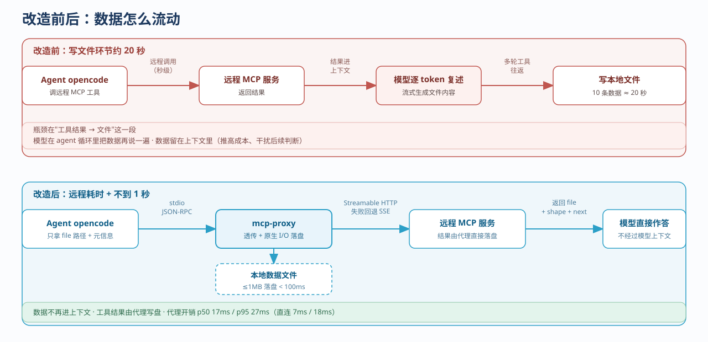
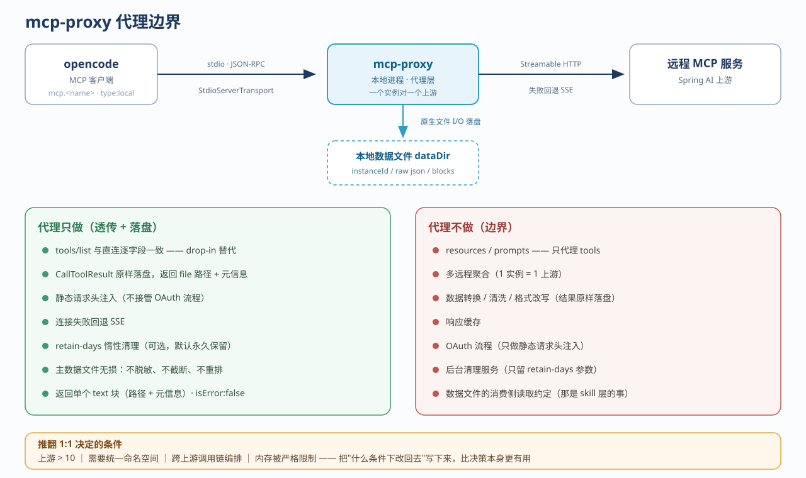
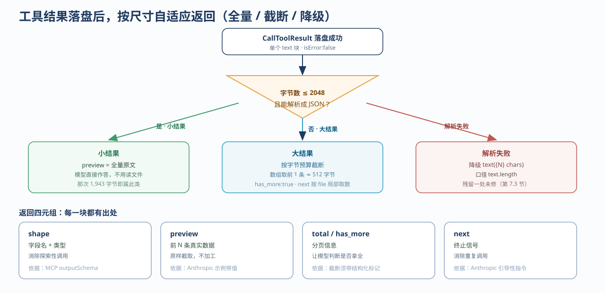
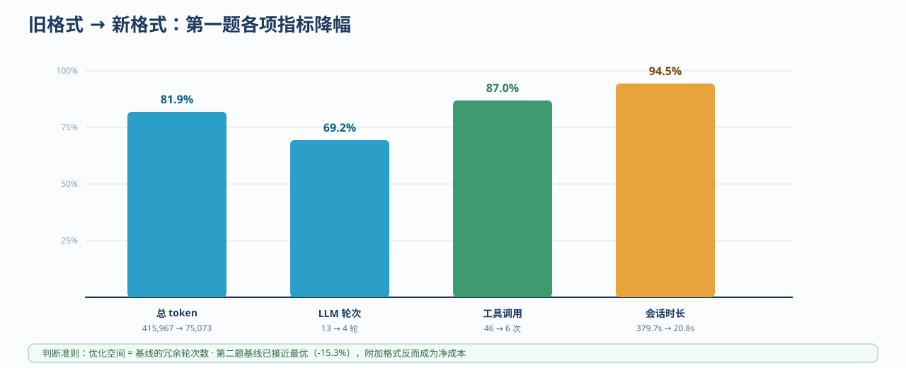

在 Agent 里调一次远程 MCP 工具，再把结果写进文件，看起来是最没有技术含量的一步。可就是这一步，把本该秒级结束的事情拖到了二十秒，还让大量返回数据留在上下文里，既推高成本，也干扰后续判断。

这篇文章记录 `mcp-proxy` 从取证到落地的过程：哪里慢、试过什么、哪些判断后来被自己的数据推翻。文中出现的耗时、token、轮次都来自项目记录，外部引用列在文末。

<!-- more -->

## 1. 一个写文件动作，二十秒

在 opencode 的 skill 场景里，流程简单得不能再简单：调用远程 MCP 服务取数据，把返回结果写进本地文件。

实测下来，10 条数据的写文件环节要 20 秒左右；同样的数据，远程调用本身（网络加远端处理）是秒级完成的。瓶颈既不在网络，也不在远端服务，而在"工具结果 → 文件"这一段。它由模型在 agent 循环里执行：读工具结果，流式生成文件内容，多轮工具往返。

磁盘 I/O 是毫秒级的，慢的是让模型把数据再说一遍。LLM 推理是计算密集型，写文件是 I/O 密集型，两件事串在一条链上，延迟只能叠加。



取证时我们给自己定了一条规矩：**证据要分级**。一手实测（对话逐字转录、真实耗时记录）算高可信；社区 issue 属于转述，只能作方向性佐证。当时 GitHub 直连不通，社区那部分是通过第三方转述拿到的，报告里直接标成"低"。把证据等级写进报告，比结论本身更有用——它决定了后面哪些判断可以当事实用，哪些只能当假设。

## 2. 两个更省事的方案，为什么都不行

动手写代理之前，先排除了两条更轻的路径。

| 方案 | 结论 | 为什么不够 |
| ---- | ---- | ---- |
| opencode 配置优化（关 LSP、关 formatter、放宽权限门） | 不够 | 只能削掉 write 工具的后处理链，削不掉"模型逐 token 复述数据"的刚性成本 |
| skill 脚本模式（MCP 结果先落临时文件，再交给脚本处理） | 不够 | 临时文件还是模型亲手写，瓶颈原样保留 |

两条路指向同一个结论：只要数据还得经过模型上下文，问题就绕不开。于是方案定为——本地进程直接对接远程 MCP，数据由进程写盘，模型只拿一个文件路径。

这就是立项依据，后来也成了整个项目的边界。

## 3. 代理的边界和在整个链路中的位置



- 对下游，它用 `StdioServerTransport` 对外扮演一个 MCP server，由 opencode 按 `mcp.<name>`（`type: "local"`）拉起。
- 对上游，它用 `StreamableHTTPClientTransport` 发起 client 连接，失败回退 SSE。
- 工具调用的结果由代理直接写入本地文件，返回给下游的是文件路径加元信息。

三条可度量的目标：

| 目标 | 度量 |
| ---- | ---- |
| 工具透传，作为直连远程的 drop-in 替代 | `tools/list` 结果与直连逐字段一致 |
| 落盘加速，只把路径与元信息返回给调用方 | ≤1MB 结果落盘 < 100ms |
| 端到端性能 | 远程调用耗时 + < 1 秒（改造前约 20 秒） |

第三条后来是靠 CI 里的基准持续守住的，不是靠某一次手工演示。这一点第 9 节再说。

边界另一侧写得同样具体。不做 `resources` / `prompts`，只代理 `tools`；不做多远程聚合，一个实例对一个上游；不做数据转换、清洗、格式改写，结果原样落盘；不做响应缓存，也不管 OAuth 流程，只做静态请求头注入；不做后台清理服务，只留一个可选的保留天数参数，落盘时顺手清理；不定义数据文件的消费侧读取约定，那是 skill 层的事。

为什么坚持一个实例对一个上游？做成 1:N 的话，工具重名要靠命名空间解决，直接破坏透明原则；配置复杂度随上游数量平方增长；任何一个上游出问题都是单点；`tools/list` 的聚合延迟还要被最慢的那个上游拖住。什么时候可以推翻这个决定，我们也写清楚了：上游超过 10 个、确实需要统一命名空间、出现跨上游的调用链编排、或者内存被严格限制。**把"什么条件下改回去"写下来，比决策本身更有用。**

## 4. 先把确定性的东西钉死

写第一行代码之前，有四件事先查清楚——它们一旦定错，后面全是返工。

### 4.1 协议版本

上游是一个基于 Spring AI 的 MCP 服务。查它的协议版本支持集：`2024-11-05`、`2025-03-26`、`2025-06-18`，上限就到 `2025-06-18`。代理这边钉死 MCP TypeScript SDK 1.30.0，其支持范围覆盖 `2024-10-07` 到 `2025-11-25`。

`2026-07-28` 那版修订不桥接。它移除了 initialize 握手，`tools/list_changed` 改由 `subscriptions/listen` 流承载。只支持这一版的上游，会在连接期显式失败。

这是有意的：**协议版本是确定性事实，宁可在连接时明确报错，也不要在运行期悄悄降级**。一旦允许"看起来能跑"，后面所有诡异现象都要从头排查。配套证据是多组 initialize 协商的原始转录、Spring AI 与 MCP Java SDK 的版本映射、官方 changelog 合辑，以及 opencode 1.16.2 的源码检视——确认它消费 `tools/list_changed`，而且这是工具清单唯一的刷新机制。

### 4.2 两个外部代理项目

`nuwax-ai/mcp-proxy`（Rust）是第一个参照。它的 README 只写了 `check` 和 `detect` 两个命令，源码里其实是五个：`convert`、`check`、`detect`、`proxy`、`health`。更要紧的是语义——`check` 只做轻量协议探测，真正建连握手的是 `health`，立项文档里引用的"check"实际对应人家的 `health`。这种偏差不看源码发现不了。

吸收了两点：输出流分离（裸值走 stdout，过程和报告走 stderr），以及 check 报告带耗时——"通但慢 3 秒"和"通且 50 毫秒"是两个完全不同的结论。没吸收的也有理由：三命令拆分，`check` 和 `detect` 语义本来就重叠；`-q` 静默模式，用不上；独立的 `--timeout` 参数，复用既有的连接超时预算就够了。

第二个是 `punkpeye/mcp-proxy`（TypeScript）。它的主方向是 stdio → HTTP，和本项目的 HTTP 上游 + stdio 下游正好正交，所以当参考架构看，不当竞品看。capability 驱动注册、progress 重标记加 abort 透传、SDK timeout 显式兜底、依赖注入点、check/detect 子命令、audit 异步写，这 6 项落了地。多客户端复用、双协议、事件存储重放、CORS/APIKey、无状态模式、会话空闲清理、请求体上限、300 秒 requestTimeout，这 8 项明确不借，每项都对应到本项目的具体条款，不是一句"看着不需要"。

顺带勘误两处：连接超时那条前提记错了，原规格本来就规定了 10 秒，缺口只是没做成可配置；commit 数记成了 305，API 实测 315。

### 4.3 日志

对比 pino、winston 和自写，看依赖体积、功能匹配度、以及与单文件分发的兼容性。pino 用 Worker Threads，和 esbuild 单文件 bundle 天然冲突，一票否决。最后自写四级日志，落 stderr，头部值打码，不到 50 行，签名与 pino 保持兼容——以后想换回去不用改调用点。

### 4.4 输出该长什么样

这份调研后来改变了整个项目的价值主张，结论放在第 6 节，这里只说方法。

翻了三类材料：MCP 规范的 `outputSchema`、Anthropic 那篇写工具的文章（截断必须带可执行的指引）、AgentPatterns 讲的三层负载——有效前缀、结构化截断标记、续接句柄。再加上下游客户端自身的工具输出上限——超过阈值就静默截断，模型看到的是一段被切掉的内容，页面上却没有任何提示。这条来自二手转述，具体阈值随版本变化，只作方向参考。

看完的共同感受是：**问题不是信息太少，是给错了类型**。`text(1130 chars)` 只告诉模型"有 1130 个字符"，模型仍然不知道里面是什么结构、有没有拿全，只能去读文件，或者重新调一遍。

## 5. 落盘契约

```
{dataDir}/
  20260902-103000-a1b2/          ← instanceId（会话层，启动时间戳 + 4 位随机）
    _instance.json               ← 实例元信息（每进程一份）
    _calls.jsonl                 ← 调用账本（每次调用追加一行）
    search_records/
      20260902-103000-001.json   ← raw 主文件（payload 或 envelope 形态）
      blocks/
        20260902-103000-001-block-0.png
```

`instanceId` 目录用 `mkdir` 的 `recursive: false` 原子创建，撞了就重新生成。多进程同秒撞名这件事，靠结构消掉，不靠概率。文件名 `yyyyMMdd-HHmmss-NNN.json` 里的 `NNN` 是进程内同步计数器，同秒多次调用也不会撞。

写文件先写同目录 `.tmp` 再 rename。写失败就返回 JSON-RPC internal error 并附上原因——不能返回一个不含文件路径的"成功"。

主文件的形态有三条规则：

| 规则 | 条件 | 文件形态 |
| ---- | ---- | ---- |
| 1 | `content` 恰为单个 `text` 块，无附加字段、无 `structuredContent` | **payload**：文件体等于 text 原文，逐字节直写，业务 JSON 可以直接被 jq 消费 |
| 2 | `content` 为空且存在 `structuredContent` | **payload**：文件体等于 `structuredContent` 的紧凑序列化 |
| 3 | 其余情况：多块、并存、空串、带附加字段 | **envelope**：上游 CallToolResult 原文信封，顶层保留 `content` 键 |

消费侧靠一个约定判别：文件顶层有 `content` 键就是信封，没有就是数据本体。任何形态都不加代理自产的 meta 包装——**主数据文件必须无损记录上游返回的数据**，不脱敏、不截断、不重排。这条不变式在后来的评审里挡掉过好几次"顺手清洗一下"的提议。

几个配套机制：

- **二进制块外存**。image / audio 块的 base64 data、resource 块的内嵌 blob，全部剔出来单独存 `blocks/`，原块位置换成相对路径。
- **调用账本**。`_calls.jsonl` 一次调用一行，`schemaVersion: 3`，记 `file`、`tool`、`arguments` 全量、`durationMs`、`isError`、`shape`。追加失败只 warn 不阻断——raw 是数据本体，账本是尽力而为。
- **保留策略**。`--retain-days` 默认 0，也就是永久保留；大于 0 时在落盘后惰性清理过期会话目录，整目录删，成本是 O(会话数)。默认不自动删是有意取舍：这些文件往往还是 skill 下游的输入，**自动删除的破坏风险高于磁盘被占满的风险**。
- **配额**。`--max-data-bytes` 默认 0（不限）。开启后在内存里做字节记账，落盘前先算预计总字节，超了直接拒绝，返回 `-32603`，磁盘上零残留；恰好等于上限允许写入。计数只活在进程内存里，重启清零——为一次写入的准头去做持久化，代价比偶尔拒绝一次大得多。

## 6. 返回给模型的是什么

落盘成功后，下游 `tools/call` 的结果必须是单个 `text` 块、`isError: false`，模板固定。真正变化的是按尺寸自适应：

- **小结果**（不超过 `inlineThresholdBytes`，默认 2048 字节，且能解析成 JSON）：preview 放全量原文，模型直接作答，不用读文件。
- **大结果**：preview 按字节预算截断（数组取前 1 条，单条约 512 字节），`has_more: true`，next 指引按 `file` 路径局部取数。
- **解析失败**：降级成 `text({N} chars)`。



返回样例：

```
[mcp-proxy] stat_student_cross ok
file: /home/work/.mcp-proxy-data/stat_student_cross/20260910-073733-001.json
items: 7 | total: 7 | has_more: false | bytes: 1639 | blocks: text:1 | duration: 7ms | at: 2026-09-10T07:37:33.733Z
shape: total:number, data[7]:{region:string, type:string, count:number}
preview:
  {"region":"北京","type":"本科生","count":150}
  {"region":"上海","type":"本科生","count":120}
  ... (共 7 条，已全部显示)
next: 数据已完整显示在 preview 中，可直接作答。如需原始文件，读取 file 路径。
```

四元组每一块都有出处：

| 信息 | 作用 | 依据 |
| ---- | ---- | ---- |
| shape | 字段名加类型，消除探索性调用 | MCP 规范的 outputSchema，用于引导客户端与模型正确解析 |
| preview | 前 N 条真实数据，原样截取 | Anthropic 的示例本身就带值 |
| total / has_more | 分页信息，让模型判断是否拿全 | 截断必须有结构化标记 |
| next | 终止信号，消除重复调用 | Anthropic：截断必须带引导性指令 |

还有一处有意为之的偏离：每个工具的 description 前面加 `[代理] ` 前缀。模型看到工具描述会默认"调用即拿到数据"，实际拿到的是路径加元信息，预期错位很容易触发重试风暴。加一句前缀，把预期提前对齐。这破坏了"逐字段透传"，但不加的话，透传本身也守不住。

## 7. 踩过的四个坑

### 7.1 SDK 那个隐性的 60 秒

MCP SDK 1.30.0 的 `Client.callTool` 里有两套互相独立的超时：`signal`（AbortSignal）和 `timeout`（毫秒，不传时 SDK 默认 60 秒生效）。

我们最初只传了 `signal`。SDK 的 60 秒默认墙一直在，用户把 `--call-timeout-ms` 调到 120 秒，配置就被静默架空：60 秒先到，报的是 `-32001`，跟"超时"这个语义对不上。

这个缺陷藏得很深。`--call-timeout-ms` 的默认值恰好也是 60 秒，和 SDK 默认值重合，所以默认参数下永远看不见——只有用户主动调大超时才会暴露。

修法是：AbortController 作为唯一中止源，SDK 的 `timeout` 只做兜底，显式传 `callTimeoutMs + 5000`。多出的 5 秒是缓冲，保证正常路径下 SDK 永远不会先于 AbortController 触发。

教训不是"要读文档"，而是**依赖库的默认行为也是一种契约**。两个默认值恰好相等，缺陷就隐形了。

### 7.2 没有心跳的 SSE

上游是 Spring AI，`type: SYNC` + `protocol: STREAMABLE`。它的 keep-alive 只有一个配置项 `keepAliveInterval`，默认 null——不配置就不发应用层心跳。而协议版本集里也没有标准的心跳机制。

最后的决定是**不加应用层心跳**，靠既有的重连加调用整体重试兜底，把风险登记成一条待验证项，等真机长调用实测后再决定。

不加的理由：版本集内 ping 的语义没定义；SYNC 模式下心跳同样占用上游线程；代理要保持薄。强行造一个心跳，等于自己发明协议。

### 7.3 字节还是字符

文档写的是"按字节判定内联阈值"，实现里用了 `.length`，也就是字符数。中文这类多字节文本，偏差最大能到 3 倍。

这个已经修了，换成 `Buffer.byteLength(text, "utf8")`，和元信息里的 `bytes` 字段同口径。残留一处：降级文案 `text(N chars)` 里的 N 还是 `text.length`。文案本身只是兜底提示，但口径不统一，迟早还会有人踩。

### 7.4 延迟必须有上界

单次 `tools/call` 的端到端延迟必须能算出来，不能"看情况"。最坏情况是：

```
2 × call-timeout + (1 + connect-retries) × connect-timeout + 退避序列总和
```

默认参数下：`2×60 + 4×10 + (1+2+4) = 167` 秒。超过这个数还挂着，就是 bug，不是慢。

## 8. 数据推翻了自己的设计

验证方法是两组模型 × 代理/无代理 × 旧格式/新格式，对人工执行记录做对比。这段结论和最初的直觉差得有点远。

### 8.1 省下的是轮次，不是上下文

模型 A 的第一题（按地区统计），从无代理切到代理新格式：

| 维度 | 无代理 | 代理新格式 | 降幅 | 贡献 |
| ---- | ---- | ---- | ---- | ---- |
| LLM 轮次 | 10 | 4 | **-60%** | 主要贡献 |
| 单轮平均 token | 24,590 | 18,768 | -23.7% | 次要贡献 |
| 总 token | 245,898 | 75,073 | **-69.5%** | 两者乘积 |

验算：`1 - (4/10) × (18768/24590) = 69.5%`。

**代理省的是"来回跑的趟数"，不是"每次看的量"**。preview 实际是完整原文（那次 1,943 字节），单次返回的内容比无代理还多——多了 file、shape、next 这些元信息。第二题也能对上：总 token 降 17.4%，其中 95% 来自轮次从 7 降到 6。

### 8.2 两天，两种格式

旧格式到新格式，同一批任务重跑：

| 维度 | 第一题（按地区统计） | 第二题（按市统计） |
| ---- | ---- | ---- |
| 总 token | 415,967 → 75,073（**-81.9%**） | 140,752 → 119,174（**-15.3%**） |
| LLM 轮次 | 13 → 4（**-69.2%**） | 6 → 6（0%） |
| 工具调用 | 46 → 6（**-87.0%**） | 11 → 8（-27.3%） |
| 会话时长 | 379.7s → 20.8s（**-94.5%**） | 181.5s → 39.9s（-78.0%） |



旧格式的 `summary: text(1130 chars)` 信息量等于零。模型既不知道数据结构，也不知道有没有拿全，只能反复探索。新格式给结构、给分页、给终止信号——**真正消掉的是模型的不确定性**。

### 8.3 效果取决于基线

| 模型 | 代理 vs 无代理 | 原因 |
| ---- | ---- | ---- |
| 模型 A | 总 token -17.4% ~ -69.5%，时长 -82% ~ -94% | 无代理基线存在大量探索性调用 |
| 模型 B | 第一题 token +3.8%（时长 -64.6%）；第二题 token +227.9% | 第二题的无代理基线已经极优（3 轮、2 次工具调用、38K token），任何附加格式都是净成本 |

判断准则只有一句：**优化空间等于基线的冗余轮次数**。基线反复重试、读文件验证、试参数，代理就有得赚；基线已经最优，代理只能增加成本。这条对任何 Agent 性能优化的预期管理都成立。

### 8.4 我们最初有四处判断是错的

1. **preview 是完整原文，不是摘要。**"数据全程不经模型上下文"这个早期说法作废，价值主张改成尺寸自适应。
2. **收益主要来自轮次减少**，占 60% 的贡献，不是压缩上下文。
3. **"32K 截断风险"不成立。**`maxSingleCallTokens` 是单次调用输入加输出的总量（实测 52,050），不是输出上限；实测输出 token 最高 3,367。那个立论只在"模型逐 token 复述写文件"这个场景下成立。
4. **模型 B 的缓存读取是轮次累积的结果，不是原因。**因果搞反了。

还有一处没修的浪费：代理已经落盘，skill 里仍然让模型 write 一份临时副本再读回来。纯双写，多出 1 到 2 次工具调用和一轮决策。修法很简单——skill 直接读 preview 里的 `file` 字段。

## 9. 交付形态与工程纪律

目标环境是物理隔离的内网，产物要人工摆渡进去。这个约束把所有"标准做法"都排除了。

npm 私服发包，依赖私服能代理公网 npm，未证实；Node SEA 单文件二进制，是 Node 20 的实验特性；tsc 多文件整目录拷贝，几百个传递依赖，摆渡时最容易漏。

最后选了 esbuild bundle 单文件 `dist/index.js`，SDK、zod 全部内联，目标机只要有 Node ≥ 20，不用 `npm install`。产物文件名带版本号，随行一个 SHA256 校验值。代价是 bundle 到了 1MB 级，排障要靠 sourcemap——而 sourcemap 留在办公网侧，不进内网。

**交付形态应该由部署环境倒推，而不是由工具链的默认习惯决定。**`npm install` 这三个字，在隔离网络里可能就是走不通。

### 9.1 质量门禁

核心模块一律先写失败测试再实现：文件存储、命名、元信息提取、配置解析、传输协商。用例命名 `should_{expected}_when_{precondition}`，`describe` 用中文，AAA 三段式。

测试分三层。E2E 用 in-memory transport 串起下游客户端、代理和内嵌假上游，把全部验收项跑成自动化；契约测试是表驱动的，管 MCP 协议面和落盘契约；再往下才是单元测试。

CI 四阶段串行：`lint → test → perf → build`。lint 以 Biome check 为断言，格式、lint、import 排序一把梭；perf 以绝对阈值为断言——代理自身开销 P95 < 500ms、1MB 结果落盘 < 100ms、10 条记录端到端 < 1s、启动 < 3s，任一超阈值直接失败。`tsc --noEmit`（strict）是硬门禁，`as any`、`@ts-ignore`、`@ts-expect-error` 一律不许出现。

第 3 节说的"端到端 < 1s"，落点就在这里：它不是一次演示，是每次提交都要过的一道门。实测数据可以对照：单次 MCP 调用的代理开销 p50 17ms、p95 27ms，直连是 7ms 和 18ms，差了大约 10ms。

### 9.2 文档不是附件

项目用 mdbook 搭了文档中心：需求规格、系统设计、实施计划、ADR 索引、部署手册、使用指南、命令总表、调研报告。**需求规格是唯一真相源**——实现和规格对不上，先确认再改代码，不让实现悄悄漂移。

一共 18 份 ADR，10 份接受、8 份提议。提议不等于没用，好几条负向决策就停在这个状态：不做下游 HTTP 监听、不做落盘数据脱敏、不对上游调用做协议级异步化。写下来的意义是，下次评审不用重新论证一遍。

调研归档的规矩是"结论为父、raw 为子"：每份结论文档挂若干原始材料，原始材料忠实留档，禁止改写或选择性摘录；结论必须基于官方文档或仓库一手来源，并标注采集日期。目前是 8 篇结论、11 份原始材料。

## 结语

这次实践最反直觉的一点是：Agent 的性能瓶颈往往不在模型本身，而在数据怎么流动。把"数据落盘"从大模型循环里拿出来、下沉到本地进程，延迟的来源就换了——从 token 生成速度换成了磁盘 I/O。

但代理真正省下的不是上下文，是轮次。**优化空间等于基线的冗余轮次数**，基线本来就没有冗余时，再精巧的输出格式也只是净成本。这个判断后来修正了我们最初的价值主张，也是最值得带走的一条。

如果只能记住三件事：先把痛点量化再立项，证据要分级；给模型的元信息要描述数据本身，而不是描述数据有多大；规范可以被数据推翻，推翻的时候把过程记下来。

## 参考

- [MCP 规范 2025-06-18 changelog](https://modelcontextprotocol.io/specification/2025-06-18/changelog)
- [MCP 规范 latest changelog（2026-07-28）](https://modelcontextprotocol.io/specification/latest/changelog)
- [MCP 规范 Tools / outputSchema（2026-07-28）](https://modelcontextprotocol.io/specification/2026-07-28/server/tools)
- [Anthropic, Writing effective tools for agents](https://www.anthropic.com/research/writing-tools-for-agents)
- [AgentPatterns, Graceful tool output truncation](https://agentpatterns.ai/tool-engineering/graceful-tool-output-truncation/)
- [opencode MCP 接入文档](https://opencode.ai/docs/mcp-servers/)
- [MCP TypeScript SDK](https://github.com/modelcontextprotocol/typescript-sdk)
- [Spring AI MCP 文档](https://docs.spring.io/spring-ai/reference/api/mcp/mcp-overview.html)
- [MCP Java SDK](https://github.com/modelcontextprotocol/java-sdk)
- [nuwax-ai/mcp-proxy](https://github.com/nuwax-ai/mcp-proxy)
- [punkpeye/mcp-proxy](https://github.com/punkpeye/mcp-proxy)
- [pino bundling 文档](https://github.com/pinojs/pino/blob/main/docs/bundling.md)
- [esbuild](https://esbuild.github.io/)

> 文中数据来自 `mcp-proxy` 项目的需求规格、调研结论文档、trace 分析记录与实测日志；外部链接采集于 2026 年 9 月。trace 数字来自项目内部的修订报告转录，原始报告未随仓库分发。
